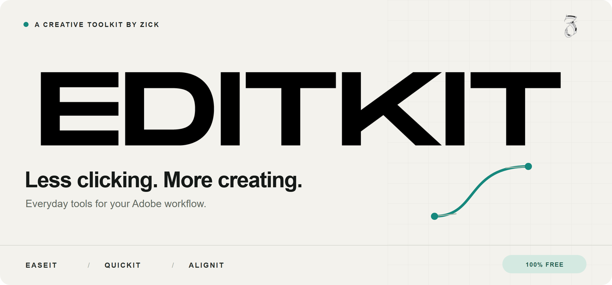
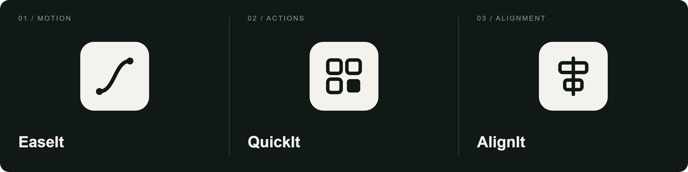

**Your everyday tools. One creative workspace.**

[Download EDITKIT — free](https://zickfx.com/b/editkit/) &nbsp; · &nbsp; [Release history](https://github.com/zickfx/editkit-updates/releases) &nbsp; · &nbsp; [Español](#español)

---

## Less clicking. More creating.

EDITKIT brings animation curves, everyday editing actions and layer alignment into one Adobe CEP panel. Built by **Zick**, free for personal and commercial projects.

### EaseIt · Shape the motion

Work with easing curves, keep your favourite curves close, and copy keyframe easing or values separately.

### QuickIt · Cut the busywork

Keep useful actions together. Search effects and presets, run scripts, organise projects and streamline repetitive tasks.

### AlignIt · Put things in place

Align layers and position anchor points with focused, composition-aware controls. **AlignIt is available in After Effects only.**

## Get started

1. **[Get the complete installation package](https://zickfx.com/b/editkit/)** from the official product page.
2. Extract the package and follow the installation instructions included with your download.
3. Open EDITKIT from Adobe's **Window → Extensions** menu. The exact menu name may vary by host version.

**Already using EDITKIT?** Open its settings, go to **About**, and choose **Check for updates**. Available updates are installed only when you choose to install them.

> **Which download should I use?** The product page is the starting point for a complete installation. ZIP files in this repository's releases are update packages; they are not necessarily the same bundle as the product-page download. The green **Code → Download ZIP** button downloads this repository, not the plugin installer.

## Compatibility & support

- **Adobe After Effects:** EaseIt, QuickIt and AlignIt.
- **Adobe Premiere Pro:** a host-specific experience; After Effects-only actions are not available. Do not assume feature parity.
- **Windows / macOS:** follow the instructions in the downloaded package. macOS installation remains experimental; compatibility depends on the host and package version.
- **Need help or have an idea?** Use **Community** in EDITKIT's settings to send a suggestion, or visit the [official product page](https://zickfx.com/b/editkit/).

When reporting a problem, include your EDITKIT version, Adobe application/version, operating system and steps to reproduce it. Remove personal paths, project names and other private details from screenshots or logs before sharing them.

---

## Español

### Menos clics. Más creación.

**EDITKIT reúne curvas de animación, acciones cotidianas y alineación de capas en un solo panel.** Creado por Zick y gratuito para proyectos personales y comerciales.

- **EaseIt:** trabaja con curvas de easing y copia por separado la interpolación y los valores de los fotogramas clave.
- **QuickIt:** reúne acciones útiles, busca efectos y presets, ejecuta scripts y reduce tareas repetitivas.
- **AlignIt:** alinea capas y coloca puntos de anclaje. Disponible únicamente en After Effects.

**[Descargar EDITKIT gratis →](https://zickfx.com/b/editkit/)**

Descarga el paquete completo desde la página oficial, extráelo y sigue las instrucciones incluidas. No uses **Code → Download ZIP** como instalador: ese botón descarga este repositorio. Si ya tienes EDITKIT, puedes buscar actualizaciones desde **Ajustes → Acerca de** y decidir cuándo instalarlas.

Para sugerencias o ayuda, entra en **Comunidad** desde los ajustes del panel. En Premiere Pro las funciones se adaptan al programa; no todas las acciones de After Effects están disponibles. La instalación en macOS sigue siendo experimental.

---

<strong>About this repository · Update-channel information</strong>

This repository hosts EDITKIT's public stable update channel and release downloads. It is not currently the complete development-source repository. Download links are not a grant of an open-source licence; consult the licence supplied with EDITKIT for the applicable terms.

### Stable integration points

- Update manifest: [`version.json`](version.json), at the root of the `main` branch.
- Existing clients use `https://raw.githubusercontent.com/zickfx/editkit-updates/main/version.json`.
- Release download URLs referenced by that manifest must remain accessible.
- The manifest's version, package URL, byte count and SHA-256 must match the published artifact.
- Package identity, internal CEP structure and signing continuity are part of release validation.

Presentation assets live in `assets/readme/` and are independent of the updater. Changing this README or those assets does not announce or install a plugin update. News feeds and release publication are managed separately.

**Made by Zick. Made to keep you creating.**

[zickfx.com](https://zickfx.com) &nbsp; · &nbsp; [EDITKIT](https://zickfx.com/b/editkit/)

